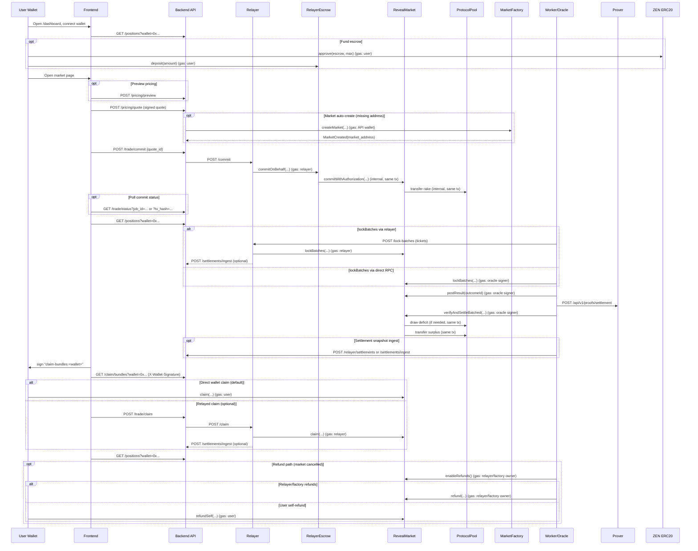

# MVP

## End-to-End Flow (Code-Verified)

Sequence diagram (current wiring):

Ordered API calls + on-chain transactions (gas payer noted):

1. GET /positions?wallet=0x... (dashboard positions + escrow balance).
2. Optional escrow funding:
   - ZEN.approve(RelayerEscrow, max) (gas: user).
   - RelayerEscrow.deposit(amount) (gas: user).
3. Optional POST /pricing/preview (unsigned preview).
4. POST /pricing/quote (signed quote).
5. Optional market auto-create (if market address missing): MarketFactory.createMarket(...) (gas: API wallet).
6. POST /trade/commit {quote_id, max_fx_diff_percent?} (API validates + consumes quote, builds CommitAuth, calls relayer).
7. Single relayer tx: RelayerEscrow.commitOnBehalf(...) which internally calls RevealMarket.commitWithAuthorization(...); rake is transferred to ProtocolPool in the same tx (gas: relayer).
8. Poll /trade/status by job_id or tx_hash until confirmed.
9. GET /positions?wallet=0x... (committed/locked status).
10. Lock commitments after deadline:
    - Via relayer: POST /lock-batches -> RevealMarket.lockBatches(...) (gas: relayer), optional /settlements/ingest.
    - Direct RPC: RevealMarket.lockBatches(...) (gas: oracle signer).
11. RevealMarket.postResult(outcomeId) (gas: oracle signer).
12. Prover request: POST /api/v1/proofs/settlement.
13. RevealMarket.verifyAndSettleBatched(...) (or verifyAndSettle(...) for single batch) (gas: oracle signer). If liability exceeds market balance, ProtocolPool.draw covers the deficit (bounded by cap) and any surplus is forwarded to the pool in the same tx.
14. Optional settlement snapshot ingest: POST /relayer/settlements or /settlements/ingest; /claim/bundles can backfill from chain if missing.
15. Claim flow:
    - Wallet signs claim-bundles:<wallet>.
    - GET /claim/bundles?wallet=0x... with X-Wallet-Signature.
    - Default: RevealMarket.claim(...) (gas: user).
    - Optional relayed claim: POST /trade/claim -> relayer /claim -> RevealMarket.claim(...) (gas: relayer).
16. GET /positions?wallet=0x... (claimed state).
17. Optional: RelayerEscrow.withdraw(amount) (gas: user).
18. Refund path (market cancelled): enableRefunds() by relayer/factory owner, then refund(...) by relayer/factory owner or refundSelf(...) by user (gas: caller).

Notes:
- /pricing/submit is not used by the UI.
- /relayer/commitments and /relayer/settlements are relayer-only hooks; /commitments/sync and /settlements/ingest are for relayer/prover backfills.

## MVP Delivery Specification (Testnet zk-proof demo)

This file describes the exact implementation scope to ship the MVP on Horizen Testnet and to demo end-to-end zk-proof settlement. Treat each section as blocking; wire logs/metrics to the unified format (`timestamp | LEVEL | logger | file:line | event | request_id`).

### 1) Environment & readiness baseline
- Defaults: chain id `2651420`, RPC `https://horizen-testnet.rpc.caldera.xyz/http`, streamer FX endpoint `http://streamer:8100/fx/zen-usd`, prover enabled only when artifacts are present.
- `/health` hard-fails when `RM_PRICING_CHAIN_ID`, `RM_PRICING_SIGNER_PRIVATE_KEY`, `PRICING_SIGNER_ADDRESS`, or RPC settings are missing/mismatched; derived signer + chain id are surfaced in the response.
- CORS/hosts: `RM_ALLOWED_HOSTS` + `RM_CORS_ALLOW_ORIGINS` must align to API + frontend origins; `/health` warns on wildcard CORS in production and checks FX host alignment.
- Migrations/backfill: API/worker run Alembic on startup; worker backfills normalized tables (outcomes, tags, clob tokens, Gamma metadata/events) and publishes schema revision keys for cache invalidation.
- Gamma stats: best_bid, best_ask, spread, volume, and open_interest are stored during ingest and surfaced in API responses and frontend mappers.

### 2) Backend pricing, quotes, caps
- Quote issuance: `/pricing/quote` ABI-packs QUOTE_V1 (chainId, market, wallet, outcomeId, stake_wei, fx_scaled 1e8, expiry, quoteId), signs with the pricing key, and persists quotes with expiry + status.
- Cap enforcement: per-bet (`RM_MAX_STAKE_ZEN`), per-user-per-market (`RM_MAX_USER_STAKE_PER_MARKET_ZEN`), and per-market (`RM_MAX_MARKET_STAKE_ZEN`) caps are enforced server-side. Defaults in the repo envs are 0.1 / 0.5 / 5 ZEN; responses include remaining caps.
- FX handling: pricing always pulls FX from the streamer endpoint, rejects stale FX, and returns `fx_received_at`/`fx_stale` metadata. `/pricing/submit` revalidates the digest, expiry, and FX drift (UI does not call it).

### 3) Frontend trading flow (relayed commit)
- Wallet/chain guard: Wagmi is pinned to Horizen Testnet (2651420) and blocks quotes/commits when the wallet is on the wrong chain; the UI can prompt a chain switch.
- Quote UX: outcome/stake picker requests `/pricing/quote`, shows expiry + FX freshness, and auto-refreshes on expiry or FX staleness. Caps are surfaced and clamp the stake input.
- Tx submission: `/trade/commit` sends the quote id to the relayer, the UI polls `/trade/status`, and the commit hash is displayed with an explorer link once available.
- Guards: submit is blocked when FX is stale, quotes are expired, or caps are exhausted; stale FX warnings and cap exhaustion messages are shown inline.

### 4) Positions + claim
- Backend: `/positions` returns wallet-scoped positions + escrow balance, claimable status, and settlement metadata; `/claim/bundles` is signature-gated.
- Frontend: `/dashboard` shows escrow balances, positions, claimable tickets, and lifecycle status. Claim uses direct on-chain `claim` with a local leaf/root check before submission; tx hash is shown with an explorer link.

### 5) Resolution ledger & automation
- Ledger persistence: resolutions, settlement snapshots, and proof receipts live in Postgres + Redis and are surfaced via `/markets`, `/markets/{event}`, and `/proofs`.
- On-chain backfills: the worker hydrates missing market addresses/params from the factory when RPC settings are available and records factory events in the ledger.
- Automation: optional lock-batches and settlement submission are driven by `RM_LOCK_BATCHES_*` and `RM_SETTLEMENT_*` envs, with relayer routing available when configured.

### 6) Proofs pipeline (zk demo critical path)
- Commitments and settlements populate DB tables; proof jobs are queued once settlements/roots are available.
- Artifacts: `prover/circuits/generate_keys.sh` writes `settlement_hashes.json` with a field-reduced circuit hash; verifier deployments and `market.circuitHash` must match that value.
- Artifact hosting (source of truth): package `prover/circuits/build` into a tar/zip, host it over HTTPS (example: `https://revealmarket.xyz/artifacts/prover-artifacts.tgz`), and set `PROVER_ARTIFACTS_URL` + `PROVER_ARTIFACTS_SHA256` so CI/prod fetches vetted artifacts without Git LFS; `prover/artifacts` is an optional mirror only.
- Prover: `/healthz` + `/metrics` report readiness and circuit hash; `go run ./cmd/verify-artifacts` validates required files/hashes.
- API exposure: `/proofs` and market detail endpoints include proof metadata (status, request_id, tx hash, batch root).
- Frontend: `/proofs` lists receipts with filters and deep links; dashboard/market views show proof availability where applicable.

### 7) Search experience
- Backend `/markets` supports full-text search + pagination; `/markets/suggest` powers typeahead suggestions.
- Frontend `/markets/search` uses server actions + load-more pagination; category chips and suggestions reuse the same backend search.

### 8) Market history/chart
- Market detail charts hydrate from the streamer `/history` endpoint and merge live WS/SSE ticks for recent points.
- Frontend: wire MarketDetail chart to real data; handle loading/empty states; update live if stream present.

### 9) CSP/CORS/FX alignment
- Streamer CORS/hosts: confirm allowlist includes frontend origin/WSS; update defaults/docs.
- Pricing FX CORS: add smoke test for `/pricing/fx` origin handling; warn on stale/fallback FX.
- Dev warnings: surface banner in frontend when streamer/API origins blocked or FX stale.

### 10) Data backfill + validation
- Run Alembic head and backfill normalized tables; verify cache hydration and feature caches (featured markets, suggest) still prime.
- Validate Gamma-derived stats in API responses and caches; add tests to ensure fields exist and are typed.

### 11) Contracts/zen tasks
- Verifier + circuit hash must stay aligned with `prover/circuits/build/settlement_hashes.json` (field-reduced hash). Update env addresses and caches after each redeploy.
- Testing: add fuzz for Merkle inclusion/replay protection, protocol cap edges (draw failures), and multi-claim sequencing.
- Deploy scripts: keep env-driven market creation and protocol cap adjustments documented (signer rotation, ownership transfer, optional timelock/pauser guidance).
- Monitoring hooks: add events/metrics for protocol pool draws and relayer credits if downstream consumers expect them.

### 12) Prover hardening
- Artifact verification is enforced by `check_artifacts.sh` and `go run ./cmd/verify-artifacts`; keep these in CI.
- Remaining: add a signed artifact manifest (not implemented yet), document recommended `PROVER_MAX_CONCURRENCY` vs memory, and add an integration test path for the C++ witness binary.

### 13) Test/QA plan (prove the zk flow)
- End-to-end script: start stack, ensure backend `/health` passes signer/FX checks, regenerate artifacts, deploy verifier, set `RM_PROVER_BASE_URL` and required signer/RPC envs.
- Happy-path demo: (1) user connects wallet on Horizen testnet; (2) requests quote, submits `/trade/commit`; (3) worker ingests commitment; (4) resolve market (manual trigger acceptable); (5) worker stores resolution ledger and requests proof; (6) prover generates proof; (7) API exposes proof on `/proofs`; (8) frontend shows proof and allows claim; (9) claim tx succeeds and ledger updates.
- Failure tests: stale FX blocks trade; expired quote rejected; wrong chain/address blocked; missing artifacts causes prover startup failure; CORS/connect-src misconfig surfaces dev warning.
- Coverage: backend tests for caps, quote persistence, resolution ledger, proof exposure; frontend tests for trading flow guards, proofs filters/CSV, positions dashboard, chart wiring; contracts/prover tests for updated circuit and verifier hash.

## MVP Readiness Runbook

This checklist closes the minimum gaps for a production-ready MVP. Use it before declaring "go" on any environment.

### 1) Test Matrix (must be green)
- Run `./scripts/mvp_check.sh` from repo root (backend tests -> frontend lint/test/build -> contracts full run -> prover artifact verification when available).
- Ensure the backend `/health` endpoint is reachable before the frontend build stage; set `FRONTEND_REQUIRE_API=true` for a hard check.

### 2) Monitoring & Alerts (minimum)
- Heartbeat staleness: alert if `RM_HEARTBEAT_KEY` older than `RM_HEARTBEAT_TTL_SECONDS`.
- Ingest errors: alert on `worker.fetch.error`/`worker.sync.skipped` spikes.
- Prover failures: alert on `worker.proof.failed` and HTTP 5xx from prover.
- Resolution gaps: alert on `worker.resolution.gaps` events.
- Cache priming: alert on `worker.cache.prime_failed` / `worker.cache.featured_failed`.
- Dashboard: expose heartbeat metrics, ingest latency, cache invalidations, prover outcomes, resolution gap counts.

### 3) Security Validation
- CORS/Allowed hosts/CSP match deployment domains (API + frontend + streamer).
- Rate limiting on public endpoints enabled (`RM_RATE_LIMIT_ENABLED=true` in prod-like envs).
- No secrets in logs; env secrets supplied via manager (no defaults in prod).
- TLS termination and redirects (HTTPS + HSTS) confirmed at the edge.

### 4) Proofs End-to-End
- Ingest real commitments/settlements into Postgres (commitment + settlement tables populated).
- Ensure `lockBatches` runs after commit deadlines so `batch_roots`/`batch_counts` land on-chain and in the settlement snapshot.
- Run worker with `RM_PROVER_BASE_URL` set and signer/RPC configured.
- Confirm proof receipts cached in Redis and settlement records carry proof metadata (request_id/hash/status).
- Verify prover health (`/healthz`) and sample proof generation succeeds with stored data.

### 5) Load / Chaos (smoke-level)
- Run a short load on worker ingest and API hot paths; watch DB/Redis pool utilization and error rates.
- Simulate Redis blips (restart or denylist) and confirm worker degrades gracefully (no crash).
- Simulate Polymarket fetch failures; confirm retries/backoff and heartbeat continue.

### 6) Deploy / Rollback
- Migrations reversible; keep `RM_RUN_MIGRATIONS_ON_STARTUP=true` but ensure Alembic downgrades exist.
- Prefer canary/blue-green deployment; validate health before promotion.
- Rollback plan: redeploy prior image/config; clear schema cache key if needed (`DEL RM_SCHEMA_VERSION_KEY`), invalidate `schema:*` tags.

### 7) Sign-off
- All tests green, alerts wired, security validated, proof path verified, load/chaos smoke passed, rollback rehearsed.

## Current State Snapshot

Implemented
- Escrow approve/deposit/withdraw + dashboard controls with chain guard and explorer-linked tx hashes.
- API auto-creates markets on quote/commit when address is missing; worker backfills `market_address` and factory params from the factory.
- QUOTE_V1 signing with per-bet/per-user/per-market caps (0.1 / 0.5 / 5 ZEN defaults); relayer commit path with `/trade/status` polling.
- Settlement pipeline from lockBatches -> postResult -> verifyAndSettleBatched, with protocol pool top-ups for deficits and surplus forwarding.
- Positions endpoint + claim flow; dashboard validates bundle leaf/root before calling `claim`.
- Ingest endpoints for relayer/prover backfills (`/commitments/sync`, `/settlements/ingest`, `/relayer/settlements`) are live.

Follow-ups (non-blocking)
- Add additional fuzz coverage around cap edges and multi-claim ordering.

## Testnet Guardrails (Horizen)

- `lockBatches`, `postResult`, and `verifyAndSettle*` are `onlyOracle`; the settlement signer is not sufficient to advance markets.
- The worker enforces that the settlement signer matches the on-chain market oracle address; if they differ, settlement automation will refuse to submit. (No `RM_ORACLE_ADDRESS` config is currently read by the worker.)
- `lockBatches` can only run after the commit window closes; until it runs, `commitmentsRoot` is zero and proofs will revert.
- Proofs must be generated against the live on-chain roots/totals; proofs against zero roots/totals will fail contract checks.
- For rapid testing, deploy a short-window market with an oracle you control or wait for commitDeadline before locking.
- If you use the relayer queue for `lockBatches`, the relayer signer must match the market oracle address (onlyOracle).

## Privacy & Claim Security

- Commitments are hashes of (ticketId, outcomeId, amount, salt, user); the market only sees the hash until settlement.
- Groth16 settlement proofs expose only aggregate totals and roots; no per-user data is revealed.
- Claims reveal the user address at claim time; salts remain private and unclaimed tickets stay sealed.
- `/claim/bundles` is wallet-scoped and signature-gated (X-Wallet-Signature); keep it rate-limited.
- The frontend validates leaf/root locally before claiming to guard against tampered bundles.

## Known Risks & Operational Notes

- `setRakeBps` can change rake after commits; consider freezing rake after the first commit or after phase != Commit. (`contracts/zen/src/RevealMarket.sol`)
- `enableRefunds` requires either commit window closure or `commitsPaused`; early cancel requires a factory pause first. (`contracts/zen/src/RevealMarket.sol`)
- Refunds require `refundsEnabled` (set by relayer/factory owner) before users can call `refundSelf`. (`contracts/zen/src/RevealMarket.sol`)

## Rake Governance Placeholder

`RM_RAKE_MANAGER_ADDRESS` exists in config for future on-chain rake governance, but there is no `RakeManager` contract in `contracts/zen` today. Keep it unset/0x0 unless you add the contract and wire the admin flows.
