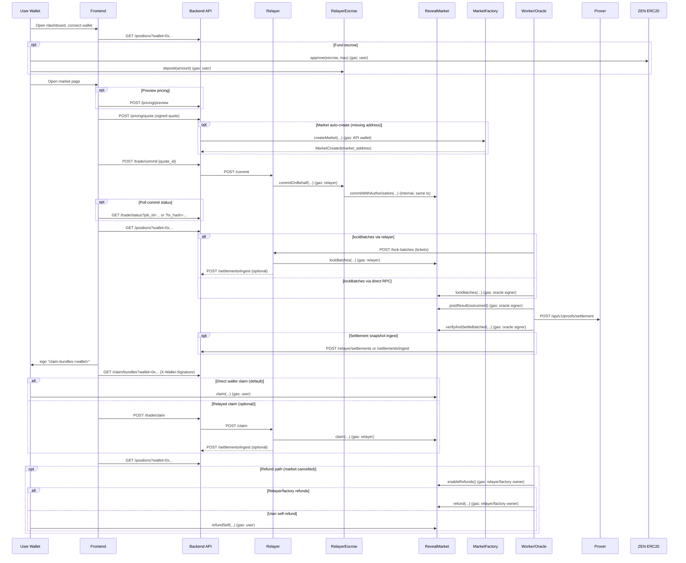

# MVP

## End-to-End Flow (Code-Verified)

Sequence diagram (current wiring):

Ordered API calls + on-chain transactions (gas payer noted):

1. GET /positions?wallet=0x... (dashboard positions + escrow balance).
2. Optional escrow funding:
   - ZEN.approve(RelayerEscrow, max) (gas: user).
   - RelayerEscrow.deposit(amount) (gas: user).
3. Optional POST /pricing/preview (unsigned preview).
4. POST /pricing/quote (signed quote).
5. Optional market auto-create (if market address missing): MarketFactory.createMarket(...) (gas: API wallet).
6. POST /trade/commit {quote_id, max_fx_diff_percent?} (API validates + consumes quote, builds CommitAuth, calls relayer).
7. Single relayer tx: RelayerEscrow.commitOnBehalf(...) which internally calls RevealMarket.commitWithAuthorization(...) (gas: relayer).
8. Poll /trade/status by job_id or tx_hash until confirmed.
9. GET /positions?wallet=0x... (committed/locked status).
10. Lock commitments after deadline:
    - Via relayer: POST /lock-batches -> RevealMarket.lockBatches(...) (gas: relayer), optional /settlements/ingest.
    - Direct RPC: RevealMarket.lockBatches(...) (gas: oracle signer).
11. RevealMarket.postResult(outcomeId) (gas: oracle signer).
12. Prover request: POST /api/v1/proofs/settlement.
13. RevealMarket.verifyAndSettleBatched(...) (or verifyAndSettle(...) for single batch) (gas: oracle signer).
14. Optional settlement snapshot ingest: POST /relayer/settlements or /settlements/ingest; /claim/bundles can backfill from chain if missing.
15. Claim flow:
    - Wallet signs claim-bundles:<wallet>.
    - GET /claim/bundles?wallet=0x... with X-Wallet-Signature.
    - Default: RevealMarket.claim(...) (gas: user).
    - Optional relayed claim: POST /trade/claim -> relayer /claim -> RevealMarket.claim(...) (gas: relayer).
16. GET /positions?wallet=0x... (claimed state).
17. Optional: RelayerEscrow.withdraw(amount) (gas: user).
18. Refund path (market cancelled): enableRefunds() by relayer/factory owner, then refund(...) by relayer/factory owner or refundSelf(...) by user (gas: caller).

Notes:
- /pricing/submit is not used by the UI.
- /relayer/commitments and /relayer/settlements are relayer-only hooks; /commitments/sync and /settlements/ingest are for relayer/prover backfills.

## MVP Delivery Specification (Testnet zk-proof demo)

This file describes the exact implementation scope to ship the MVP on Horizen Testnet and to demo end-to-end zk-proof settlement. Treat each section as blocking; wire logs/metrics to the unified format (`timestamp | LEVEL | logger | file:line | event | request_id`).

### 1) Environment & readiness baseline
- Chain/env defaults: chain id `2651420`, RPC `https://horizen-testnet.rpc.caldera.xyz/http`, streamer FX endpoint `http://streamer:8100/fx/zen-usd`, prover enabled only when artifacts present. Ensure `RM_PRICING_CHAIN_ID`, signer key/address, and env vars are loaded; add a health/smoke check that fails fast if missing.
- CORS/CSP/connect-src: align API + streamer + frontend origins; update defaults and dev warnings when blocked. Ensure pricing FX endpoint passes CORS smoke test.
- Migrations/backfill: apply Alembic head (`0001_initial_schema.py`) and backfill normalized tables (outcomes, tags, clob tokens, market_gamma_metadata, gamma_raw). Confirm health probes see schema.
- Gamma stats exposure: surface bestBid/bestAsk/spread/volume/openInterest from Gamma into API schemas (MarketSummary/MarketDetail) and worker serialization; ensure cache tags update.
- Current gaps to close:
  - Defaults: `RM_PRICING_CHAIN_ID`/RPC/signer are unset (`None`) and `.env` still points at Polygon; pin Horizen defaults and derive signer address for checks.
  - Health: pricing signer check only degrades on missing envs; add a hard fail for missing/mismatched chain id, signer key/address, and RPC alignment; assert `PRICING_SIGNER_ADDRESS` presence.
  - CORS/CSP: API CORS only warns on wildcard; CSP connect-src still `self` so origin drift goes undetected. Streamer logs mismatches but has no smoke for frontend origin; frontend lacks dev warnings. Add a CORS/CSP smoke test proving `/pricing/fx` is reachable from the configured origin.
  - Schema/backfill: health only does `SELECT 1`; it never asserts Alembic head or schema version key. Add revision checks and ensure markets are backfilled into normalized tables with cache tags invalidated.
  - Gamma metrics: worker doesn't populate bestBid/bestAsk/spread/openInterest; API schemas and cache enrichment don't expose them; frontend types/mappers ignore them. Map through ingestion -> models -> API responses -> cache tags and update frontend types/consumers.

### 2) Backend pricing, quotes, caps
- Quote issuance: `/pricing/quote` must ABI-pack QUOTE_V1 (chainId, market, wallet, outcomeId, stake_wei, fx_scaled 1e8, expiry, quoteId), sign with pricing key, and persist quotes durably (status, expiry, consumed_at). Reject missing/mismatched fields; log request_id and quoteId.
- Signer health: tighten `_check_pricing_signer` so `/health` surfaces derived chain id + signer address, compares against env values, and returns `error` when chain id or key is missing/mismatched. Include derived signer address/chain in health detail; fail fast when `PRICING_SIGNER_ADDRESS` disagrees with the derived key or when `RM_PRICING_CHAIN_ID` differs from env.
- Cap enforcement: drop the per-bet cap to 0.1 ZEN (`max_stake_zen`), require `market_id` + `wallet_address` for quote issuance (treat `user_id` as deprecated), and ensure errors return structured limits (max + remaining per-user/per-market) alongside the failure reason. Enforce per-user-per-market and per-market caps server-side even when clients omit IDs; include remaining caps in successful responses. Add tests for boundary cases (exactly at cap, just over cap, missing IDs, mixed consumed/issued quotes, stale quote expiry in cap sums).
- FX handling: always pull FX from the streamer endpoint and propagate `stale` + `received_at`/timestamp metadata into `/pricing/fx` and quote responses so the frontend can block stale trades. `/pricing/fx` should warn and 503 when using fallback or stale data instead of silently returning 200. `/pricing/quote`/`/pricing/submit` should reject stale FX, surface the FX timestamp/age in responses, and use the streamer timestamp when checking drift.

### 3) Frontend trading flow (relayed commit)
- Wallet/chain guard: enforce Horizen Testnet (2651420) in wagmi config + runtime; block quote/trade UI on wrong/missing chain or wallet. Prompt network switch CTA and auto-refresh quotes when chain/account changes; never reuse quotes from the wrong chain. Display connected chain vs pricing signer/chain returned by the API in the trade panel.
- Quote UX: outcome/stake picker calls `/pricing/quote` with wallet+market+outcome, renders live expiry countdown, FX timestamp/age/source, and caps. Auto-refresh quotes on expiry, chain drift, FX stale->fresh transitions, or manual refresh. Normalize error reasons (stale FX, missing wallet, wrong chain, caps exhausted). Keep a single shared FX WS connection per session (canonical `/fx/zen-usd` path) and reuse it across pages.
- Cap/stake enforcement: apply the 0.1 ZEN per-bet cap plus API caps (max/remaining per-user and per-market) to stake inputs and CTA disabled state. If remaining cap is 0, block quotes/trades and show the cap reason. Do not floor caps to 0.1 when API returns 0; clamp stakes to the smallest non-null cap and message the adjustment.
- Tx submission: submit `/trade/commit` with the quote id and surface relayer tx pending/confirmed states (wait for receipt) with hash display. Handle specific failures (expired/consumed quote, wrong chain/signature) with tailored messaging and auto-refresh quote on revert. Keep escrow funding (approve + deposit) visible and keep submission blocked on wrong network or stale FX.
- Stale/cap guards + FX alignment: disable submit when FX is stale, quote expired, or caps exceeded; show explicit reason. Standardize FX path (`/fx/zen-usd` with alias to `/fx/zen-usdc`) and expose `received_at/lastUpdate` in the FX state so UI can display freshness and enforce guards.

### 4) Positions + claim
- Backend: expose positions endpoint (wallet-scoped) with stakes, entry FX, current FX, PnL, potential winnings, volume, aggregated stats; include claimable status.
- Frontend: positions dashboard showing active/resolved positions, PnL, potential winnings, totals; single "Claim winnings" CTA per claimable set.
- Claim flow: frontend calls RevealMarket.claim directly with bundle proof data; backend/worker mirrors claim in DB and updates resolution ledger/positions on success; show tx status and refreshed balances.

### 5) Resolution ledger & automation
- Ledger persistence: on resolution ingest, store condition ID, payouts, winners, oracle/question IDs, block number/timestamp, tx hash, and payload snapshot in Postgres + Redis. Expose via `/markets`, `/markets/{event}`, `/proofs`.
- On-chain mirroring: stream MarketFactory events (MarketCreated, GlobalRakeUpdated, AuthorizationSignerUpdated, OracleUpdated, MarketRelayerUpdated, pause events) into DB/Redis to prevent drift.
- Automation (optional flag): when payouts finalized, queue settlement transactions or alert ops with duplicate suppression and retry logging. Respect env toggle.
- Health/metrics: emit counters for resolution gaps, automation retries, and ledger writes.

### 6) Proofs pipeline (zk demo critical path)
- Worker ingest: ensure commitments and settlements populate DB tables; resolution ledger ties to proofs.
- Prover artifacts: regenerate Groth16 artifacts for updated settlement circuit (liability cap removed, 10 public signals). Publish verifying key hash and update on-chain verifier/circuitHash (contracts/zen).
- Prover service: on startup, verify artifacts (existence + optional hash); expose `/healthz` and `/metrics` (add Prometheus histograms/gauges for latency, inflight, errors). Document allowed origins/ingress.
- Proof requests: worker issues settlement proof requests to prover when market resolved and commitments present; store request_id/hash/status/timestamps; cache proofs in Redis.
- API exposure: `/proofs` and market detail endpoints include proof metadata (status, request_id, hash, created_at, verifier). Include resolution ledger info.
- Frontend: proofs page supports filters (status/verifier/market), CSV export, diligence CTA; detail view shows proof metadata. Claim/positions flow displays proof availability where relevant.
- Demo script: provide step sequence to show commit -> resolution ingest -> proof generated -> claim succeeds on testnet using regenerated artifacts.

### 7) Search experience
- Backend endpoint: build search API with pagination, category pills, and keyboard shortcut support; returns markets ordered by relevance.
- Frontend: replace client-only filter with backend results; add pagination controls, category chips, and keyboard shortcuts.

### 8) Market history/chart
- Data source: provide historical price/liquidity from backend/streamer history endpoint; ensure SSE/WS or polling delivers recent points.
- Frontend: wire MarketDetail chart to real data; handle loading/empty states; update live if stream present.

### 9) CSP/CORS/FX alignment
- Streamer CORS/hosts: confirm allowlist includes frontend origin/WSS; update defaults/docs.
- Pricing FX CORS: add smoke test for `/pricing/fx` origin handling; warn on stale/fallback FX.
- Dev warnings: surface banner in frontend when streamer/API origins blocked or FX stale.

### 10) Data backfill + validation
- Run Alembic head and backfill normalized tables; verify cache hydration and feature caches (featured markets, suggest) still prime.
- Validate Gamma-derived stats in API responses and caches; add tests to ensure fields exist and are typed.

### 11) Contracts/zen tasks
- Regenerate Groth16 artifacts for settlement circuit; update verifier and `circuitHash`; redeploy to testnet; document addresses.
- Testing: add fuzz for Merkle inclusion/replay protection, protocol cap edges (draw failures), multi-claim sequencing.
- Deploy scripts: build env-driven scripts for market creation and protocol cap adjustments; include signer rotation/ownership notes and optional timelock/pauser guidance.
- Monitoring hooks: add events/metrics for protocol pool draws and relayer credits if downstream consumers expect them.

### 12) Prover hardening
- Artifact verification: optionally add hash checks in `check_artifacts.sh`/startup to prevent stale/poisoned zkeys.
- Metrics: expand `/metrics` with Prometheus histograms/gauges for latency, inflight jobs, errors.
- CLI tooling (optional): add `go run ./cmd/verify-artifacts` to report circuit hash/artifact presence for CI gates.
- Runtime pinning: document `PROVER_RAPIDSNARK_BINARY` and Node versions for deployment manifests.

### 13) Test/QA plan (prove the zk flow)
- End-to-end script: start stack, ensure backend `/health` passes signer/FX checks, regenerate artifacts, deploy verifier, set `RM_PROVER_BASE_URL` and required signer/RPC envs.
- Happy-path demo: (1) user connects wallet on Horizen testnet; (2) requests quote, submits `/trade/commit`; (3) worker ingests commitment; (4) resolve market (manual trigger acceptable); (5) worker stores resolution ledger and requests proof; (6) prover generates proof; (7) API exposes proof on `/proofs`; (8) frontend shows proof and allows claim; (9) claim tx succeeds and ledger updates.
- Failure tests: stale FX blocks trade; expired quote rejected; wrong chain/address blocked; missing artifacts causes prover startup failure; CORS/connect-src misconfig surfaces dev warning.
- Coverage: backend tests for caps, quote persistence, resolution ledger, proof exposure; frontend tests for trading flow guards, proofs filters/CSV, positions dashboard, chart wiring; contracts/prover tests for updated circuit and verifier hash.

## MVP Readiness Runbook

This checklist closes the minimum gaps for a production-ready MVP. Use it before declaring "go" on any environment.

### 1) Test Matrix (must be green)
- Run `./scripts/mvp_check.sh` from repo root (backend tests -> frontend lint/test/build -> contracts full run -> prover artifact verification when available).
- Ensure the backend `/health` endpoint is reachable before the frontend build stage; set `FRONTEND_REQUIRE_API=true` for a hard check.

### 2) Monitoring & Alerts (minimum)
- Heartbeat staleness: alert if `RM_HEARTBEAT_KEY` older than `RM_HEARTBEAT_TTL_SECONDS`.
- Ingest errors: alert on `worker.fetch.error`/`worker.sync.skipped` spikes.
- Prover failures: alert on `worker.proof.failed` and HTTP 5xx from prover.
- Resolution gaps: alert on `worker.resolution.gaps` events.
- Cache priming: alert on `worker.cache.prime_failed` / `worker.cache.featured_failed`.
- Dashboard: expose heartbeat metrics, ingest latency, cache invalidations, prover outcomes, resolution gap counts.

### 3) Security Validation
- CORS/Allowed hosts/CSP match deployment domains (API + frontend + streamer).
- Rate limiting on public endpoints enabled (`RM_RATE_LIMIT_ENABLED=true` in prod-like envs).
- No secrets in logs; env secrets supplied via manager (no defaults in prod).
- TLS termination and redirects (HTTPS + HSTS) confirmed at the edge.

### 4) Proofs End-to-End
- Ingest real commitments/settlements into Postgres (commitment + settlement tables populated).
- Ensure `lockBatches` runs after commit deadlines so `batch_roots`/`batch_counts` land on-chain and in the settlement snapshot.
- Run worker with `RM_PROVER_BASE_URL` set and signer/RPC configured.
- Confirm proof receipts cached in Redis and settlement records carry proof metadata (request_id/hash/status).
- Verify prover health (`/healthz`) and sample proof generation succeeds with stored data.

### 5) Load / Chaos (smoke-level)
- Run a short load on worker ingest and API hot paths; watch DB/Redis pool utilization and error rates.
- Simulate Redis blips (restart or denylist) and confirm worker degrades gracefully (no crash).
- Simulate Polymarket fetch failures; confirm retries/backoff and heartbeat continue.

### 6) Deploy / Rollback
- Migrations reversible; keep `RM_RUN_MIGRATIONS_ON_STARTUP=true` but ensure Alembic downgrades exist.
- Prefer canary/blue-green deployment; validate health before promotion.
- Rollback plan: redeploy prior image/config; clear schema cache key if needed (`DEL RM_SCHEMA_VERSION_KEY`), invalidate `schema:*` tags.

### 7) Sign-off
- All tests green, alerts wired, security validated, proof path verified, load/chaos smoke passed, rollback rehearsed.

## Current State Snapshot

Implemented
- Escrow approve/deposit/withdraw + dashboard controls with chain guard.
- API auto-creates markets on quote/commit when address is missing; worker can backfill `market_address` and factory params from the factory.
- QUOTE_V1 signing + caps; relayer commit path and relayer queue status polling.
- Positions endpoint + dashboard claim flow; dashboard validates bundle leaf/root before calling claim.
- Ingest endpoints exist for relayer/prover backfills (`/commitments/sync`, `/settlements/ingest`, `/relayer/settlements`).

Gaps / follow-ups
- Ensure relayer/prover/worker ingestion is wired so commitments + settlement snapshots are persisted for `/claim/bundles`.
- Align pricing caps and frontend guards with the 0.1 ZEN per-bet target.
- Enforce pricing signer/chain/RPC checks in `/health` (see section 2).

## Testnet Guardrails (Horizen)

- `lockBatches`, `postResult`, and `verifyAndSettle*` are `onlyOracle`; the settlement signer is not sufficient to advance markets.
- `lockBatches` can only run after the commit window closes; until it runs, `commitmentsRoot` is zero and proofs will revert.
- Proofs must be generated against the live on-chain roots/totals; proofs against zero roots/totals will fail contract checks.
- For rapid testing, deploy a short-window market with an oracle you control or wait for commitDeadline before locking.
- If you use the relayer queue for `lockBatches`, the relayer signer must match the market oracle address (onlyOracle).

## Privacy & Claim Security

- Commitments are hashes of (ticketId, outcomeId, amount, salt, user); the market only sees the hash until settlement.
- Groth16 settlement proofs expose only aggregate totals and roots; no per-user data is revealed.
- Claims reveal the user address at claim time; salts remain private and unclaimed tickets stay sealed.
- `/claim/bundles` is wallet-scoped and signature-gated (X-Wallet-Signature); keep it rate-limited.
- The frontend validates leaf/root locally before claiming to guard against tampered bundles.

## Known Risks & Operational Notes

- `setRakeBps` can change rake after commits; consider freezing rake after the first commit or after phase != Commit. (`contracts/zen/src/RevealMarket.sol`)
- `enableRefunds` requires either commit window closure or `commitsPaused`; early cancel requires a factory pause first. (`contracts/zen/src/RevealMarket.sol`)
- Refunds require `refundsEnabled` (set by relayer/factory owner) before users can call `refundSelf`. (`contracts/zen/src/RevealMarket.sol`)

## Rake Governance Placeholder

`RM_RAKE_MANAGER_ADDRESS` exists in config for future on-chain rake governance, but there is no `RakeManager` contract in `contracts/zen` today. Keep it unset/0x0 unless you add the contract and wire the admin flows.
