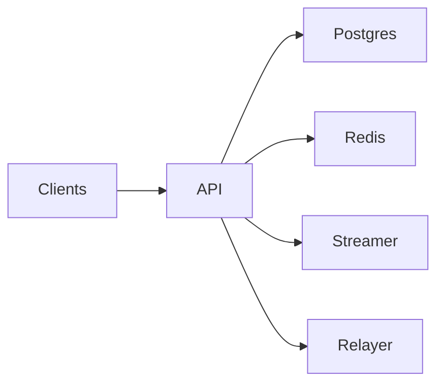

# Reveal Market API Service

FastAPI service that powers every customer-facing surface: curated market feeds, resolution summaries, partner analytics, and automation hooks. It shares SQLAlchemy models and cache helpers with the worker to keep persistence, logging, and schema state aligned.

---

## High-Level Architecture

1. **Startup wiring**: `app.server.create_app` loads settings, configures logging/CORS/security middleware, initializes Goldsky (when configured), runs migrations, validates the on-chain verifier circuit hash (when RPC + verifier config are present), records the schema revision tag, and starts background tasks (cache refresh, quote sweeps, relayer queue processing, API heartbeat metrics).
2. **Request flow**: HTTP request enters middleware (request ID, structured logs, rate limiting, security headers) then hits route handlers. Cacheable endpoints read/write Redis JSON keys with tags; cache misses fall back to async SQLAlchemy queries before shaping responses.
3. **Pricing and trade**: `/pricing/quote` fetches FX from the streamer, signs the QUOTE_V1 digest, and stores quotes in Postgres; `/trade/commit` validates quotes, signs CommitAuth payloads, and forwards to the relayer (or Redis queue fallback).
4. **Observability**: `/healthz` fans out to DB, Redis, worker heartbeat, Polymarket, pricing signer, schema revision, and CORS/FX CORS checks. `/metrics` exports Prometheus counters, and a Redis heartbeat publishes rolling request stats.



## 1. Responsibilities at a Glance

| Area | What the API handles |
| --- | --- |
| Market discovery | `/markets`, `/categories/{slug}`, `/markets/suggest` (all Redis-backed) |
| Market detail & settlement | `/markets/{event_id}` and `/resolution/{condition_id}` with sync invalidation from the worker |
| Trade + relayer | `/pricing/quote`, `/pricing/preview`, `/pricing/submit`, `/trade/commit`, `/positions`, `/claim/bundles`, `/trade/claim`, `/trade/status`, relayer ingest hooks |
| Health/metrics | `/healthz` fans out to DB, Redis, worker heartbeat, Polymarket, pricing signer, schema revision, and CORS/FX CORS checks; `/metrics` exposes Prometheus counters |
| Security surface | Trusted hosts, strict CORS/CSP/HSTS headers, `SecurityHeadersMiddleware` |
| Observability | Structured logs + request IDs, Prometheus instrumentation, cache hit/miss counters |

> **Note:** Proof receipts and settlement summaries require the worker to be running with Redis + Postgres connectivity. The `prover` container emits real Groth16 proofs (rapidsnark + the Circom artifacts under `prover/circuits/build`) and fails fast if those files are missing. Refresh the proving/verifying keys via `prover/circuits/generate_keys.sh` before promising zk-grade receipts to partners.

---

## Current implementation snapshot

- **Lifespan** – Runs Alembic migrations, validates on-chain verifier circuit hash when configured, records the schema revision tag, configures logging/CORS/security headers, builds async Postgres/Redis clients, and starts background loops (cache refresh, quote sweeps, relayer queue, API heartbeat).
- **Caching** – List/detail/resolution payloads cached in Redis JSON with schema + logical tags; startup and interval hydrators repopulate `/markets`, categories, and suggest. Clean bypass when Redis is down (no tag pollution).
- **Search & detail** – Market payloads are normalized tables (outcomes/tags/clob tokens/Gamma metadata); legacy JSON columns removed. `/markets`, `/categories/{slug}`, `/markets/suggest`, `/markets/{event}` are async + cache-tagged; search uses indexed Postgres vectors (no cache).
- **Health/metrics** – `/healthz` fans out to DB, Redis, worker heartbeat, Polymarket, pricing signer, schema revision, and CORS/FX CORS checks; `/metrics` exports Prometheus HTTP/cache/rate-limit counters. `/live`/`/ready` remain probe-friendly.
- **Signed pricing** - `/pricing/quote` ignores client FX, pulls FX from the streamer endpoint (hard-pinned in `app.pricing`), enforces stake caps, signs QUOTE_V1 digest (chain id, market, wallet, outcome, stake_wei, fx_scaled 1e8, expiry, quoteId) with `RM_PRICING_SIGNER_PRIVATE_KEY`, and persists quotes in Postgres; `/pricing/preview` returns unsigned previews; `/pricing/submit` revalidates digest/expiry/FX drift and marks quotes consumed.
- **Trade + relayer** - `/trade/commit` consumes a quote, builds CommitAuth signatures, forwards to the relayer (with Redis queue fallback), and records commitment snapshots; `/positions`, `/claim/bundles`, `/trade/claim`, and `/trade/status` expose claim/settlement state; relayer ingest hooks can push commitments plus settlement roots/counts from `lockBatches` so proofs can be generated per batch.
- **Rate limiting** - Async Redis-backed middleware with trusted proxy allowlist plus in-memory fallback; disabled by default.
- **Observability** – Structured logs with request_id, Prometheus instrumentation, cache hit/miss counters, API heartbeat payloads in Redis, quote expiry sweeper, and Python healthcheck scripts for Docker probes.

---

## 2. Architecture & Request Lifecycle

1. **Startup**: `app.server` loads settings, configures logging, runs Alembic migrations via `app.database.run_migrations()`, validates the on-chain verifier circuit hash (when configured), records the schema revision tag, starts background loops, and wires middleware (TrustedHost, CORS, security headers, Prometheus).
2. **Async-first**: Route handlers and background tasks stay async; any blocking third-party clients (for example CLOB orderbook fetches) run via `asyncio.to_thread` so the uvicorn loop never stalls.
3. **Request entry**: `request_context_middleware` assigns/propagates `x-request-id`, measures latency, and emits structured events (`http.request.*`).
4. **Routing**:
   - Read endpoints hit Redis first (`shared.cache_async.get_json`). Cache keys are tagged (schema tag, logical tags like `markets:list`) for precise invalidation.
   - On cache miss the handler calls `app.crud`, which wraps SQLAlchemy queries around `shared.models`.
5. **Response shaping**: `schemas.MarketResponse` is built from normalized tables (outcomes/tags/clob tokens/Gamma metadata); legacy JSON columns (`outcomes`, `outcome_prices`, `tags`, `clob_token_ids`, `extra_data`) were removed.
6. **Cache writes**: payloads are dumped to Redis JSON, TTL’d via `RM_CACHE_TTL_SECONDS`, and tagged for invalidation by the worker.
7. **Hydration cycle**: On startup (and every `RM_CACHE_REFRESH_INTERVAL_SECONDS` thereafter) the API queries Postgres for the newest `RM_CACHE_HYDRATE_LIMIT` markets and rewrites the homepage cache. That keeps Redis warm even before the first client request and ensures any worker-led Postgres updates are reflected in cache within seconds.

---

## 3. Repository Map

```
backend/api/
├── app/
│   ├── server.py            # FastAPI app factory + middleware wiring (async-only)
│   ├── runtime.py           # Shared runtime state (cache client, metrics, settings)
│   ├── http_middleware.py   # Logging/CORS/security/rate-limit middleware
│   ├── rate_limit.py        # Async Redis-backed rate limiter + middleware
│   ├── metrics_registry.py  # Prometheus metric definitions
│   ├── tasks.py             # Background cache refreshers + heartbeats
│   ├── routes/              # HTTP routers (markets, pricing, proofs, treasury, meta)
│   ├── services/            # Cache clients, heartbeat dashboards, market/proof helpers
│   ├── utils/               # Request helpers (content-length estimation, cache metadata)
│   ├── crud.py              # Async SQLAlchemy helpers
│   ├── schemas.py           # Pydantic response + request models
│   ├── config.py            # Pydantic Settings (RM_* env vars)
│   ├── database.py          # Async engine/session factory + migration hook
│   ├── health.py            # Dependency checks for /health
│   ├── security.py          # CSP/HSTS middleware
│   ├── logging_config.py    # Service-wide logging setup
│   └── onchain.py           # Optional MarketFactory introspection
├── tests/                   # Pytest suite (async + REST; uses redis.asyncio + asyncpg)
├── pyproject.toml           # Runtime + dev dependencies (managed with uv)
├── uv.lock                  # Resolved lockfile
└── run.py                   # Local entrypoint (uvicorn wrapper)
```

---

## 4. Configuration Reference

All values use the `RM_` prefix (example: `RM_DATABASE_URL`). Defaults live in `app.config.Settings`.

### Core service

| Variable | Description |
| --- | --- |
| `RM_DATABASE_URL` | SQLAlchemy DSN (example `postgresql+psycopg2://user:<REDACTED>@host:5432/db`). |
| `RM_DATABASE_POOL_SIZE` / `RM_DATABASE_MAX_OVERFLOW` | Connection pool sizing. |
| `RM_REDIS_URL` | Redis connection string for caching + health checks. |
| `RM_CACHE_TTL_SECONDS` | Default TTL for cached responses. |
| `RM_CACHE_HYDRATE_ON_STARTUP`, `RM_CACHE_HYDRATE_LIMIT` | Toggle and size the Postgres→Redis priming pass that runs during API startup so cold boots still respond instantly. |
| `RM_CACHE_REFRESH_ENABLED`, `RM_CACHE_REFRESH_INTERVAL_SECONDS`, `RM_CACHE_REFRESH_LIMIT` | Background refresher that rehydrates the newest markets every N seconds so Redis stays aligned with Postgres even without traffic. |
| `RM_SCHEMA_VERSION_KEY` | Redis key updated by the worker so the API can invalidate caches when schema revisions change. |
| `RM_ALLOWED_HOSTS` | CSV consumed by Starlette’s TrustedHost middleware. |
| `RM_CORS_ALLOW_*` | Origins/methods/headers/credentials for CORS. |
| `RM_ENABLE_SECURITY_HEADERS` | Toggles CSP/HSTS/COOP middleware. |
| `RM_MARKET_CATEGORY_ALLOWLIST` | Optional filters to hide markets that don’t belong to pre-approved segments. |
| `RM_MAX_STAKE_ZEN` | Per-quote stake cap (UI surfaces 0.1 ZEN max; quotes above this return 400). |
| `RM_MAX_USER_STAKE_PER_MARKET_ZEN` | Per-user cumulative cap per market (used when `market_id` + `wallet_address` are provided). |
| `RM_MAX_MARKET_STAKE_ZEN` | Per-market cumulative cap across all users. |
| FX feed | Pricing fetches FX from the streamer endpoint and ignores client FX. The fetcher is currently hard-pinned to `http://streamer:8100/fx/zen-usd` in `app.pricing` (settings kept for future overrides). Quotes reject when FX is stale/unavailable and responses include FX freshness metadata. |
| `RM_PRICING_SIGNER_PRIVATE_KEY`, `RM_PRICING_CHAIN_ID`, `PRICING_SIGNER_ADDRESS` | Required for signed quotes. The API signs an ABI-packed QUOTE_V1 digest (chain id, market address, wallet, outcome, stake wei, FX 1e8, expiry, quoteId) that is validated and consumed off-chain by `/pricing/submit` and `/trade/commit`. |

### How the pipeline stays fresh

1. **Gamma ingestion (worker)** – The worker polls Polymarket Gamma with Polygon + status filters, normalizes the payload into `MarketPayload`, and upserts rows via `shared.repository`.
2. **Postgres as source of truth** – Every market mutation runs inside a DB transaction. Once committed, the worker invalidates the relevant Redis tags (`market:{id}`, `markets:list`, etc.).
3. **API cache hydration** – On startup the API reads the newest markets from Postgres and writes sanitized records to Redis (`market:<event_id>` records + the homepage `markets:list` payload). A background refresher repeats this process every `RM_CACHE_REFRESH_INTERVAL_SECONDS`, so Redis reflects DB state even if no HTTP clients have arrived yet.
4. **Serving the frontend** – `/markets` (and category endpoints) read from Redis when available. Cache misses fall back to Postgres, reusing the same sanitization logic, and responses reach the frontend in the same shape whether they came from Redis or the DB.
5. **Search + pagination** – These paths intentionally bypass cache to keep Redis small; Postgres’ indexed queries shoulder the work, while any hits to the homepage automatically benefit from the hydration loop.

### Polymarket/on-chain

| Variable | Description |
| --- | --- |
| `RM_POLYMARKET_API_BASE`, `RM_POLYMARKET_TIMEOUT_SECONDS`, `RM_POLYMARKET_ORDER`, `RM_POLYMARKET_SORT_ASCENDING`, `RM_POLYMARKET_ONLY_OPEN_MARKETS` | Control how `/healthz` checks the upstream feed. |
| `RM_RPC_URL`, `RM_FACTORY_ADDRESS`, `RM_MARKET_IMPLEMENTATION_ADDRESS`, `RM_RAKE_MANAGER_ADDRESS`, `RM_VERIFIER_ADDRESS`, `RM_CIRCUIT_HASH`, `RM_WALLET_ADDRESS`, `RM_WALLET_PRIVATE_KEY` | Required only for `/markets/onchain` or when the API needs to interact with on-chain data. When `RM_RPC_URL`, `RM_VERIFIER_ADDRESS`, and `RM_CIRCUIT_HASH` are set, startup validates the on-chain verifier hash matches the configured circuit. |
| `RM_POLYGON_RPC_URL`, `RM_POLYGON_CTF_ADDRESS`, `RM_POLYMARKET_CLOB_HOST` | Optional overrides for Polygon + CLOB integrations. |

Use `.env` or `SETTINGS_FILE` to load a dedicated config file (see `app.config.get_settings()`).

### Pricing & signed quotes

- `/pricing/quote` requires `market_id`, `wallet_address`, and `outcome_id`; `market_address` is optional and auto-created when missing. It ignores any client-supplied FX, fetches FX from the streamer endpoint, and signs the QUOTE_V1 digest (`QUOTE_V1`, chainid, market, expectedUser, outcomeId, stake_wei, zen_usd_scaled, expiry, quoteId).
- `/pricing/submit` verifies the same digest, enforces expiry, and optionally checks FX drift vs the live feed. Quotes are stored in Postgres with the expiry sweeper; Redis is not used for quote persistence.
- Set `RM_PRICING_CHAIN_ID` to the chain where markets live; keep the signer key private and expose `PRICING_SIGNER_ADDRESS` for clients/ops that want to display the active signer.
 - Liveness probe: `/live` (no deps). Readiness probe: `/ready` or `/healthz` (checks DB, Redis, worker heartbeat, Polymarket, pricing signer, schema revision, CORS, FX CORS). Metrics: `/metrics`.

#### QUOTE_V1 digest (do not change without backend/frontend coordination)

The signed pricing payload uses a fixed digest for API validation and client integrity:

```
keccak256(
  "QUOTE_V1",
  chainid,
  market,          // address
  expectedUser,    // wallet address
  outcomeId,       // uint256
  stakeWei,        // uint256
  fxScaled1e8,     // uint256
  expiry,          // uint256 unix timestamp
  quoteId          // bytes32
)
```

`app.server.build_quote_digest` (and the test suite) enforce this shape. Changing it requires coordinated backend/frontend updates (contracts are unaffected unless you add on-chain enforcement).

### Trade + relayer

| Variable | Description |
| --- | --- |
| `RM_AUTHORIZATION_SIGNER_PRIVATE_KEY` | Private key used to sign CommitAuth payloads for `commitWithAuthorization`. |
| `RM_AUTHORIZATION_SIGNER` | Expected on-chain signer address for CommitAuth verification. |
| `RM_RELAYER_BASE_URL` | Base URL for relayer commit/claim calls. |
| `RM_RELAYER_BEARER_TOKEN` | Optional bearer token for relayer auth. |
| `RM_RELAYER_QUEUE_ENABLED`, `RM_RELAYER_QUEUE_KEY` | Enable and configure Redis-backed relayer queue fallback. |
| `RM_RELAYER_QUEUE_MAX_ATTEMPTS`, `RM_RELAYER_QUEUE_RESULT_TTL_SECONDS` | Retry policy and TTL for queued relayer jobs. |
| `RM_RELAYER_WEBHOOK_SECRET` | Shared secret for relayer ingestion hooks (`/relayer/commitments`, `/relayer/settlements`). |
| `RM_TICKET_SIZE_WEI`, `RM_COMMIT_NONCE_TTL_SECONDS` | CommitAuth sizing and nonce expiry settings. |
| `RM_RELAYER_ESCROW_ADDRESS` | Optional escrow contract address used for balance checks. |

### Operations & runbook (API)

- Probes: `/live` (liveness) and `/ready`/`/healthz` (readiness: DB, Redis, worker heartbeat, Polymarket, signer, CORS). Metrics at `/metrics`.
- Cache strategy: versioned keys (`v1:`) with tag invalidation; startup and jittered refresh hydrators; hydrate lock prevents stampedes; clean bypass when Redis is unavailable.
- Pricing quotes: FX fetched server-side with retry/backoff + cache (streamer endpoint); per-user/per-market caps enforced via the quote ledger; quote expiry sweeper runs in the background (interval configurable via `RM_QUOTE_EXPIRY_SWEEP_INTERVAL_SECONDS`).
- Relayer queue: failed relayer calls are queued in Redis (`RM_RELAYER_QUEUE_KEY`) and replayed by the background loop; `/trade/status` resolves job ids once results are recorded.
- Clearing caches: bumping cache version or flushing Redis keys with prefix `v1:` invalidates prior entries. Tags (`cache:tag:*`) group list/detail/resolution keys; hydrators will repopulate hot paths.

---

## 5. Local Development Workflow

### Prerequisites
- Python 3.12+
- Postgres + Redis (run `./run_local.sh` or `docker compose up postgres redis`)
- [`uv`](https://docs.astral.sh/uv/) CLI for dependency management (`curl -LsSf https://astral.sh/uv/install.sh | sh`)

### Setup & Run

```bash
cd backend/api
uv sync --extra dev --no-install-project   # creates .venv with deps only (code runs from source)

# Copy env template (edit values as needed)
cp ../.env.example .env.local
export SETTINGS_FILE=.env.local

# Start the API (uv prefers the synced virtualenv automatically)
uv run --project . python run.py
# or hot-reload:
uv run --project . uvicorn app.server:app --reload --host 0.0.0.0 --port 8000
```

Useful commands:

```bash
uv run --project . --extra dev ruff check
uv run --project . --extra dev pytest -q
uv run --project . python -m app.healthcheck
curl -H "accept: application/json" http://localhost:8000/markets
```

---

## 6. Database & Migration Strategy

1. Migrations live in `backend/migrations` at the repo root (shared with worker).
2. On startup the API calls `app.database.run_migrations()` which delegates to `shared.migrations.run_migrations`. This ensures hot reloads don’t serve requests before schemas are current.
3. Adding a schema change:
   ```bash
   cd backend/migrations
   alembic revision -m "describe change"
   alembic upgrade head
   ```
4. The worker records the applied revision in Postgres + Redis. The API tags caches with `schema:{revision}` so new schema changes automatically invalidate stale JSON.

---

## 7. Caching Model

- All list/detail endpoints first attempt `shared.cache_async.get_json(redis_client, key)`.
- Cache keys come from `shared.cache_keys` (`markets:list:{filters}`, `markets:category:<slug>`, etc.).
- Each cached payload is tagged with:
  - Schema tag (`schema:<rev>`), so when migrations land the worker can nuke the whole cohort.
  - Logical tags (`markets:list`, `market:{event_id}`, `resolution:{condition_id}`) so the worker invalidates only impacted entries after it writes new data.
- TTL defaults to `RM_CACHE_TTL_SECONDS` (5 minutes by default). Override per route if needed.
- If Redis is offline/unreachable, endpoints now bypass the cache entirely, log the bypass, and avoid registering tags—preventing misleading “cache miss” logs and dangling tag sets during outages. Category caches only tag results when a payload is actually written.

---

## 8. Security Posture

- **Transport**: Expect TLS termination at the load balancer. Enforce HTTPS via HSTS header (`Strict-Transport-Security`).
- **Headers**: `SecurityHeadersMiddleware` sets CSP, Referrer-Policy, COOP/CORP, Permissions-Policy, and frame protections. `/docs`, `/redoc`, `/openapi.json` receive relaxed CSP to allow FastAPI assets.
- **CORS**: Locked down via environment variables; defaults to permissive (`*`) for local development.
- **Trusted Hosts**: Deny requests where `Host` is not whitelisted (unless `RM_ALLOWED_HOSTS="*"`).
- **Request IDs**: All logs include `request_id`; clients can provide `X-Request-ID` to propagate across systems.

---

## 9. Observability & Operations

| Surface | How to use |
| --- | --- |
| Metrics | `GET /metrics` (Prometheus format, includes HTTP latencies, cache hit counters, instrumented by `prometheus_fastapi_instrumentator`). |
| Health | `GET /healthz` or run `python -m app.healthcheck`. The HTTP endpoint aggregates DB, Redis, worker heartbeat, Polymarket, pricing signer, schema revision, and CORS/FX CORS checks. |
| Logs | Structured via `logging_config.setup_logging()`. Configure with `LOG_LEVEL`, `LOG_TO_FILE`, `LOG_DIR`, `LOG_MAX_BYTES`, `LOG_BACKUP_COUNT`. |
| Profiling slow queries | Set `RM_DATABASE_ECHO=true` or attach `SQLALCHEMY_SILENCE_UBER_WARNING=1` for verbose output. |

Operational best practices:
- Keep Redis and Postgres close to the API to minimize cache/query latency.
- Monitor cache hit ratio (`markets_cache_requests_total`) to ensure warm paths stay hot.
- Alert when `/healthz` returns `degraded` or `error` to catch upstream outages early.

---

## 10. Testing Matrix

```bash
cd backend
./run_tests.sh         # uses uv run to execute API + worker suites

# or run API-only tests
cd backend/api
uv run --project . --extra dev pytest -q
```

`./backend/run_tests.sh` fans pytest across four workers per suite by default. Set `PYTEST_WORKER_COUNT=<n>` to override the level of parallelism (for example, throttling CI runners or squeezing more throughput out of a high-core workstation).

What the suite covers:
- Route contracts (200/404/422 behaviors, cache behavior via fakes)
- Allowlist filtering, slug decoding, metadata augmentation
- Health checks with dependency stubs
- Permissionless endpoints and error handling

Add new tests under `backend/api/tests` following the `test_*.py` convention. Use `pytest.mark.asyncio` for async tests and `fakeredis` or provided fixtures to avoid hitting real Redis.

---

## 11. Deployment Checklist

1. Build via repo root `docker/api/Dockerfile` or `make api`.
2. Provide environment:
   - Postgres reachable via `RM_DATABASE_URL`
   - Redis reachable via `RM_REDIS_URL`
   - Worker publishing schema revision/heartbeats (so `/health` stays green)
3. Configure ingress to set `X-Forwarded-Proto`/`X-Forwarded-For` if you rely on access logs.
4. Expose `/metrics` behind auth if deploying on the public internet.
5. Run `python -m app.healthcheck` as the container `HEALTHCHECK` command (already wired in Dockerfile).
6. Ensure environment secrets (RPC URLs, private keys) are injected via secret manager rather than baked into images.

---

## 12. Troubleshooting

| Symptom | Likely cause | Fix |
| --- | --- | --- |
| `/healthz` returns `degraded: worker` | Worker heartbeat key missing or expired. | Ensure worker publishes heartbeats (`RM_HEARTBEAT_KEY`) and Redis is reachable. |
| `/markets` always cache-miss | Worker not publishing `RM_SCHEMA_VERSION_KEY`, causing repeated schema-tag invalidation. | Verify worker logs `worker.schema.version_cached` and that Redis stores the revision. |
| Requests hang at startup | Migrations running or DB unreachable. | Check logs for `worker.schema.synced` / `alembic` output, ensure Postgres credentials are correct. |
| 403 errors behind ingress | TrustedHost mismatch. | Set `RM_ALLOWED_HOSTS` to include the ingress hostname or `*` for testing. |
| CSP violations on docs | CDN assets blocked. | Update `docs_csp` overrides in `app.server` if you introduce new assets. |

---

## 13. Reference Commands

```bash
# Format & lint
ruff check backend/api
black backend/api

# Generate OpenAPI schema
uvicorn app.server:app --reload --port 8000 &
curl http://localhost:8000/openapi.json > openapi.json

# Load test a route
hey -n 1000 -c 50 http://localhost:8000/markets
```

The API is intentionally small, deterministic, and cache-heavy—keep new routes consistent with this model and reuse the shared helpers whenever possible.

---
