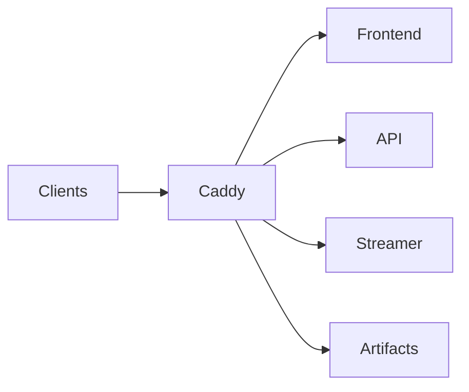

# Caddy deployment notes

## High-Level Architecture

1. **Custom Caddy build**: `docker/caddy/Dockerfile` builds Caddy with the Cloudflare DNS module via `xcaddy`.
2. **Reusable Caddyfile snippets**: shared snippets define headers, caching, logs, health checks, and reverse proxies.
3. **Host routing**: vhosts front the Next.js frontend, FastAPI API, and streamer; static prover artifacts are served directly.

## Build and runtime

- **Image build**: `CADDY_VERSION` pins the builder/runtime images. The binary is granted `cap_net_bind_service` so it can bind 80/443 as the `caddy` user.
- **Config validation**: the image runs `caddy validate` at build time to fail fast on syntax errors.
- **Admin API**: Caddy listens on `127.0.0.1:2019` for health checks.
- **Origin protection (prod)**: when Cloudflare proxy (orange cloud) is enabled, lock down ports 80/443 at the host firewall to Cloudflare IP ranges only, removing the open `allow 80/tcp` and `allow 443/tcp` rules. This keeps the origin private while still allowing Cloudflare to reach Caddy.

## Routing and behavior

- `revealmarket.xyz`:
  - serves `/artifacts/*` from `/srv/artifacts` with immutable caching
  - proxies all other traffic to `frontend:3000`
- `stream.revealmarket.xyz`:
  - proxies to `streamer:8100`
  - applies `cache_no_store`
  - uses JSON access logs (`access_log_json`)
- `api.revealmarket.xyz`:
  - proxies to `api:8000` with `Host` header set to `api.revealmarket.xyz`
  - applies `cache_no_store`
  - uses JSON access logs (`access_log_json`)
- `www.revealmarket.xyz`:
  - 308 redirect to `https://revealmarket.xyz{uri}`
- `/healthz` on each host is handled directly by Caddy via `health_common`.

## TLS and environment knobs

- `CADDY_TLS_PROFILE` selects a snippet for TLS setup:
  - `tls_prod`: Cloudflare DNS-01 with `CLOUDFLARE_API_TOKEN` and the Cloudflare resolvers.
  - `tls_local`: internal CA for local/dev use.
- `CADDY_TLS_PROFILE` defaults to `tls_local` in the Dockerfile to keep build-time validation working.
- `CADDY_LOG_LEVEL` and `CADDY_ACCESS_LOG_LEVEL` tune log verbosity for `log_common` and `access_log_json`.

## Reverse-proxy health checks

- Frontend upstream uses `health_uri /` with short timeouts and `max_fails=2`.
- API upstream uses `health_uri /live` (cheap liveness) with `Host` override (`api.revealmarket.xyz`).
- Streamer upstream uses `health_uri /healthz` with `Host` override (`stream.revealmarket.xyz`).

## Artifact hosting

- `/artifacts/*` is served from `/srv/artifacts` (mounted from `./artifacts` in `docker-compose.prod.yml`) so `PROVER_ARTIFACTS_URL` can be fetched over HTTPS without Git LFS.

## Cloudflare cache rules (recommended)

- Cache static assets aggressively and respect origin headers:
  - `revealmarket.xyz/_next/static/*` -> Cache Everything, Edge TTL 1 year, Browser TTL 1 year
  - `revealmarket.xyz/_next/image*` -> Cache Everything, Edge TTL 1 day (or respect origin Cache-Control)
  - `revealmarket.xyz/artifacts/*` -> Cache Everything, Edge TTL 1 year
- Bypass cache for dynamic/API/SSE:
  - `api.revealmarket.xyz/*` -> Cache Bypass
  - `stream.revealmarket.xyz/*` -> Cache Bypass (WebSockets enabled)
- Keep "Origin Cache Control" enabled so Next.js ISR headers are honored.
