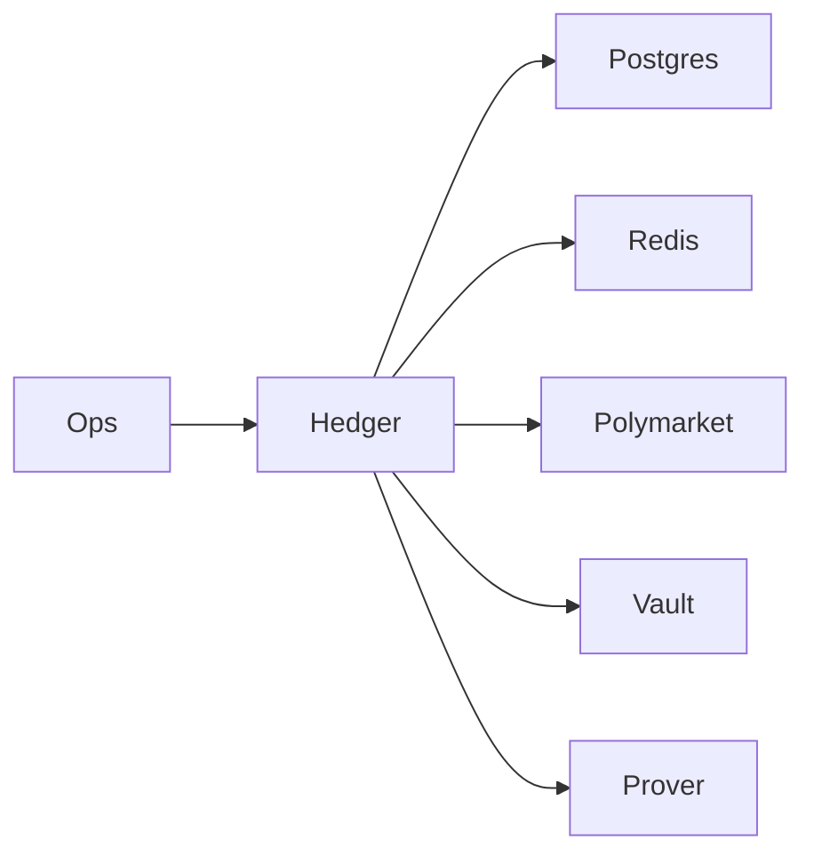

# Reveal Hedger

The Hedger keeps RevealMarket economically neutral while preserving privacy. It ingests commits, converts ZEN exposure into hedges on Base/Polymarket, manages LP vault utilization and float, coordinates proof-based settlement, and exposes operator-facing APIs/metrics.

## High-Level Architecture
1. **Startup**: load settings, configure logging, build clients (FX oracle, Polymarket, bridge, vault), connect Redis for locks/idempotency, run DB migrations, and hydrate exposure state from Postgres.
2. **Commit ingestion**: `/admin/commits` validates FX freshness and optional signed quotes, enforces per-commit caps, updates exposure ledgers, and emits hedge instructions plus risk breaches.
3. **Hedging execution**: hedges quote and submit Polymarket orders, enforce slippage caps, borrow/repay from the LP vault, and record fills + utilization metrics.
4. **Settlement**: builds prover payloads from stored commits, requests proofs from the prover, persists receipts, and marks markets resolved (on-chain submission is not wired yet).
5. **Ops**: `/healthz`, `/metrics`, and `/admin/*` endpoints expose exposure snapshots, risk reports, positions, bridge actions, and settlement triggers.



## What’s inside
- FastAPI admin API (`/admin/...`) plus Prometheus metrics (`/metrics`) and health probes.
- Exposure + risk: tracks YES/NO vectors per market, net deltas, FX haircuts, coverage ratios, and risk limits; emits buy/sell/unwind hedge instructions (partial unwinds when over-hedged).
- FX + slippage: FX oracle cache with staleness enforcement and haircut; hedges are rejected if quotes exceed `HEDGER_MAX_SLIPPAGE_BPS`.
- Persistence + recovery: Postgres audit trails for commits (with idempotency keys), hedge actions (including unwind flag), settlements, resolved markets, treasury snapshots, and replay offsets; restart hydration rebuilds exposures/hedged USD from stored aggregates.
- Concurrency + idempotency: Redis locks + idempotency for commit ingestion and hedge execution, plus DB duplicate checks; stream offsets stored for replay safety.
- Metrics: exposures, net exposure, coverage ratio, LP utilization, float balance, PnL placeholders, event lag, hedge executions, and settlement/prover latency histograms.
- Settlement orchestration: builds lightweight prover payloads from stored commits + outcome, persists receipts, marks markets resolved, and clears exposure (on-chain submission is stubbed).
- Pricing guardrails: hedges refuse stale FX and enforce per-commit stake caps; default cap is 1000 ZEN (tune via `HEDGER_RISK_MAX_COMMIT_ZEN`) and haircuts/worsen/rake are applied server-side.

## Current implementation snapshot
- **State model** – `hedger_commits`, `hedger_hedge_actions`, `hedger_settlements`, `hedger_offsets`, `hedger_resolved_markets`, and `hedger_treasury_snapshots` store commits, hedge actions, settlement receipts, and treasury snapshots. Hydration rebuilds YES/NO vectors and hedged USD on startup.
- **Exposure ingestion** – Commit ingestion expects backend/chain events with idempotency keys; Redis locks + DB uniqueness stop duplicates. Offsets are persisted for replay (not yet wired into a streaming consumer).
- **Risk/FX gating** – FX cache enforces staleness + haircut; slippage ceiling via `HEDGER_MAX_SLIPPAGE_BPS`. Risk checks evaluate per-commit caps, per-market/global exposure, coverage ratio targets, LP utilization, and float thresholds, returning breach reports alongside hedge instructions.
- **Hedging actions** – Buy/sell/unwind instructions are persisted with execution payloads/response bodies; partial unwinds occur when over-hedged. The Polymarket client and vault client are live HTTP/Web3 wrappers; bridge calls are lightweight HTTP submissions to an external bridge service.
- **Settlement path** – Given stored commits + outcome, the hedger builds a lightweight prover payload (commit list + totals), requests proofs, stores receipts, marks resolved markets, and clears exposure. Full batch circuit payload assembly and on-chain submission are not wired yet.
- **API/metrics** – Admin API exposes exposures, risk config, positions, offsets, and settlements; Prometheus histograms for hedge latency, prover latency, coverage ratios, and event lag. Health probes check Postgres + Redis + FX reachability.

## Running locally
The Docker image is wired into `docker-compose.yml` as `hedger`. To start it alongside the rest of the stack:

```bash
./run_local.sh hedger
```

Useful env vars (defaults live in `app/config.py`):

- `RM_DATABASE_URL` – Postgres URL (defaults to the shared `postgres` service).
- `HEDGER_REDIS_URL` – Redis URL for lightweight locks/state.
- `HEDGER_POLYMARKET_API_BASE` – Base URL for Polymarket REST/GraphQL.
- `HEDGER_FX_FEED_URL` – Trusted ZEN/USD feed (align with API/streamer endpoint, e.g., http://streamer:8100/fx/zen-usd).
- `HEDGER_FX_FEED_ALT_URL` – Optional secondary FX feed used if the primary feed is unreachable.
- `HEDGER_FX_HAIRCUT_BPS` – FX haircut in basis points (e.g., 500 = 5% haircut).
- `HEDGER_PRICING_SIGNER_ADDRESS` – If set, all commits must carry a signed quote from this address; validation occurs before hedging.
- `HEDGER_RISK_MAX_GLOBAL_EXPOSURE_USD` – Cap on aggregate USD exposure.
- `HEDGER_RISK_MAX_PER_MARKET_USD` – Per-market exposure cap before throttling.
- `HEDGER_FLOAT_MIN_ZEN` – Minimum ZEN float before triggering a bridge top-up.
- `HEDGER_MAX_SLIPPAGE_BPS` – Max allowed slippage for hedge placement (bps).
- `HEDGER_PROVER_BASE_URL` – Prover base URL for settlement proof requests.
- `HEDGER_PROVER_SHARED_SECRET` – Optional shared secret; when set, the hedger sends `X-Prover-Secret` to the prover.
- `HEDGER_LP_VAULT_ADDRESS` – On-chain LP vault address (Polygon/Base).
- `HEDGER_VAULT_RPC_URL` / `HEDGER_VAULT_CHAIN_ID` – RPC + chain id for vault transactions.
- `HEDGER_VAULT_PRIVATE_KEY` / `HEDGER_VAULT_SENDER_ADDRESS` – Key + sender used to sign vault borrow/repay.
- `HEDGER_VAULT_GAS_PRICE_GWEI` – Optional gas price override for vault transactions.
- Network defaults: Horizen Testnet (chain id `2651420`, RPC `https://horizen-testnet.rpc.caldera.xyz/http`, explorer `https://horizen-testnet.explorer.caldera.xyz`). Keep signer/treasury addresses and pricing chain id aligned with this network when running end-to-end demos.

API docs and metrics during local runs:
- Health: `http://localhost:8090/healthz`
- Admin: `http://localhost:8090/admin/exposures`, `.../risk`, `.../positions`
- Metrics: `http://localhost:8090/metrics`
