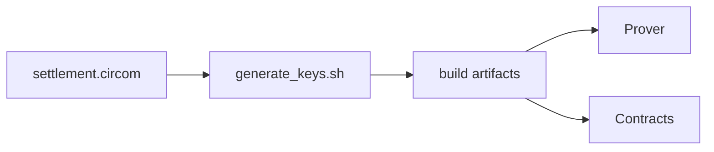

# Groth16 Settlement Circuit

This directory hosts the reference circuit and helper scripts needed to generate the Groth16 proving/verification keys consumed by both the `prover` microservice and the Solidity verifier. The Go service boots a rapidsnark-backed prover using the artifacts produced here and refuses to start when they are missing, guaranteeing that every proof is generated with the real circuit.

## High-Level Architecture



## Prerequisites

- Node >= 18 plus `curl`/`tar` (the script auto-downloads the circom binary, circomlib source, and uses `npx snarkjs@0.7.4` if missing)
- Optional: `circom` installed globally for faster runs (otherwise the official GitHub binary is cached under `build/.circom-bin/`)
- Optional: `snarkjs` installed globally (set `USE_SYSTEM_SNARKJS=true` to use it)
- Internet access to download the Powers of Tau file (default: `powersOfTau28_hez_final_21.ptau` from `storage.googleapis.com/zkevm/ptau/...`)
- Apple Silicon: Rosetta is required because the upstream circom release is x86_64-only

## Files

| File | Description |
| --- | --- |
| `settlement.circom` | Batch settlement circuit (see below). |
| `generate_keys.sh` | Compiles the circuit, downloads PTAU, runs Groth16 setup, computes Keccak-256 hashes and `circuitHash`, and emits deploy-ready JSON. |
| `export_artifacts.sh` | Copies `build/` outputs into `prover/artifacts` for submodule storage. |
| `import_from_artifacts.sh` | Pulls the `prover/artifacts` mirror back into `build/` on a fresh checkout. |

## Circuit: `settlement.circom`

**Version**: circom 2.1.5, using circomlib `Poseidon` and `comparators`.

### Constants

| Constant | Value |
| --- | --- |
| `BATCH_SIZE` | 256 (fixed-size ticket array; inactive slots must have `amount=0`, `payout=0`) |
| `MERKLE_DEPTH` | 8 (depth-8 Poseidon Merkle tree over 256 leaves) |

### Private inputs

| Signal | Shape | Description |
| --- | --- | --- |
| `commitmentsCount` | scalar | Number of active tickets (1–256) |
| `ticketId` | `[256]` | Ticket identifier |
| `outcomeId` | `[256]` | 0 = YES, 1 = NO |
| `amount` | `[256]` | Escrowed amount |
| `payout` | `[256]` | Winning payout |
| `user` | `[256]` | User address (as field element) |
| `salt` | `[256]` | Per-ticket random salt (must be < BN254 scalar field order) |

### Public signals (in order)

| Index | Signal | Description |
| --- | --- | --- |
| 0 | `merkleRoot` | Poseidon Merkle root of 256 leaves |
| 1 | `marketId` | Market identifier |
| 2 | `winningOutcomeId` | 0 = YES won, 1 = NO won |
| 3 | `totalEscrow` | Sum of all ticket amounts (`poolTotalYes + poolTotalNo`) |
| 4 | `totalLiability` | Sum of winning-side payouts only |
| 5 | `rakeBps` | Protocol rake in basis points (0–10000) |
| 6 | `poolTotalYes` | Sum of YES ticket amounts |
| 7 | `poolTotalNo` | Sum of NO ticket amounts |
| 8 | `circuitHash` | Circuit identity hash (field-reduced mod BN254) |
| 9 | `padding` | Always 0; enforces 10-signal length |

### Leaf construction

Each leaf is computed with five nested Poseidon(2) calls:

```
userSalt  = Poseidon(user, salt)
h1        = Poseidon(ticketId, outcomeId)
h2        = Poseidon(amount, payout)
h3        = Poseidon(h2, userSalt)
rawLeaf   = Poseidon(h1, h3)
leaf      = rawLeaf * isActive   // inactive slots contribute zero
```

The 256 leaves are then folded into a depth-8 Poseidon Merkle tree to produce `merkleRoot`.

### Constraints enforced

- `rakeBps <= 10000`
- `winningOutcomeId` is 0 or 1 (MVP: YES/NO only)
- `commitmentsCount <= 256`
- Inactive rows (`i >= commitmentsCount`) must have `amount == 0` and `payout == 0`
- Each active ticket's `outcomeId` is 0 or 1
- `poolTotalYes + poolTotalNo == totalEscrow`
- `totalLiability == sum of payout for tickets on the winning side`
- `padding == 0`

## Build outputs (under `build/`)

| File / Directory | Description |
| --- | --- |
| `settlement_final.zkey` | Groth16 proving key — mount in the `prover` container |
| `settlement_vk.json` | Verification key — canonical source for the Solidity verifier |
| `settlement_hashes.json` | Keccak-256 hashes of proving key, verification key, witness script, and WASM; also contains `circuitHash`, `circuitName`, `circuitVersion`, and `batchSize` |
| `settlement_deploy.json` | Deploy-ready verifier JSON (also copied to `contracts/cache/` and `contracts/zen/cache/`) |
| `settlement_js/` | Node.js witness generator (`generate_witness.js`, `settlement.wasm`, `witness_calculator.js`) |
| `settlement_cpp/` | C++ witness generator artifacts (optional fast path) |
| `settlement.r1cs` | R1CS constraint system |
| `circomlib/` | Cached circomlib sources for deterministic builds |
| `.circom-bin/` | Cached circom binary (auto-downloaded when not on PATH) |
| `warmup_request.json` | Pre-built valid proof request used by `POST /api/v1/proofs/warmup` |

## Usage

```bash
cd prover/circuits

# Compile circuit + run Groth16 setup
bash generate_keys.sh

# Export artifacts into the submodule mirror
bash export_artifacts.sh

# Import artifacts from the submodule mirror (fresh checkout)
bash import_from_artifacts.sh
```

To install hosted artifacts (CI/prod):

```bash
cd prover
PROVER_ARTIFACTS_URL="https://revealmarket.xyz/artifacts/prover-artifacts.tgz" \
  PROVER_ARTIFACTS_SHA256="<sha256>" \
  ./scripts/download_artifacts.sh
```

## After regenerating keys

1. Redeploy the Solidity verifier (rerun `forge script ... Deploy.s.sol`) so the on-chain contract picks up the new verifying key from `contracts/cache/settlement-vk.json`.
2. Mount `build/settlement_final.zkey` plus either `build/settlement_js/` (Node witness) or `build/settlement_cpp/settlement` (C++ witness) in the `prover` container.
3. Update `prover/artifacts` submodule and bump `circuitVersion` in `settlement_hashes.json`.

`./run_local.sh` and `./run_prod.sh` refuse to start the prover unless the artifacts listed above exist under `prover/circuits/build`. Set `SKIP_PROVER_CHECK=true` only when audited assets are already mounted elsewhere.
