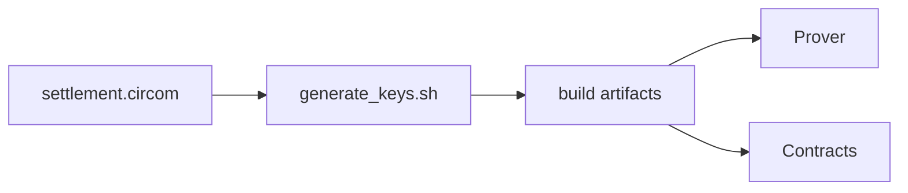

# Groth16 Settlement Circuit

This directory hosts the reference circuit and helper scripts needed to generate the Groth16 proving/verification keys consumed by both the `prover` microservice and the Solidity verifier. The Go service boots a rapidsnark-backed prover using the artifacts produced here and refuses to start when they’re missing, guaranteeing that every proof is generated with the real circuit.

## High-Level Architecture



> **Prerequisites**
>
> - Node ≥ 18 plus `curl`/`tar` (the script auto-downloads the circom binary, circomlib source, and uses `npx snarkjs@0.7.4` if missing)
> - Optional: `circom` installed globally for faster runs (otherwise the official GitHub binary is cached under `build/.circom-bin/`)
> - Optional: `snarkjs` installed globally (set `USE_SYSTEM_SNARKJS=true` to use it)
> - Internet access to download the Powers of Tau file (default: `powersOfTau28_hez_final_21.ptau` from `storage.googleapis.com/zkevm/ptau/...`)
> - Apple Silicon: Rosetta is required because the upstream circom release is x86_64-only today.

## Files

| File | Description |
| --- | --- |
| `settlement.circom` | Batch settlement circuit: consumes 256-ticket Poseidon leaves, computes the depth-8 Merkle root + pool totals, and exposes ten public signals (merkleRoot, marketId, winningOutcomeId, totalEscrow, totalLiability=sum of winning payouts, rakeBps, poolYes, poolNo, circuitHash, padding=0). |
| `generate_keys.sh` | Bash script that compiles the circuit, downloads the PTAU file, runs Groth16 setup, computes proving/verification key hashes + circuitHash, and emits deploy-ready JSON. |

Constants and hash alignment:
- `BATCH_SIZE = 256`, `MERKLE_DEPTH = 8` (one batch = one depth-8 Poseidon tree).
- Poseidon parameters must match BN254 circomlib and the Solidity `PoseidonT3`/`PoseidonT4` libraries.

## Usage

```bash
cd prover/circuits

# Compile circuit + run Groth16 setup
bash generate_keys.sh

# Outputs (under build/):
#   settlement.r1cs           -> constraint system
#   settlement_js/            -> witness generator artifacts
#   settlement_cpp/           -> C++ witness generator artifacts
#   settlement_final.zkey     -> proving key (mount in prover container)
#   settlement_vk.json        -> verification key (canonical source for hashing)
#   settlement_hashes.json    -> proving/verification key hashes + circuitHash (field-reduced mod BN254), plus circuitName/circuitVersion
#   settlement_deploy.json    -> deploy-ready verifier JSON (also copied to contracts/cache/settlement-vk.json and contracts/zen/cache/settlement-vk.json)
#   circomlib/                -> cached circomlib sources for deterministic builds
#   .circom-bin/              -> cached circom binary (auto-downloaded when not on PATH)
```

The hosted archive is the source of truth for CI/prod. Package `build/` into a tar/zip, upload it to your HTTPS host, and set `PROVER_ARTIFACTS_URL` + `PROVER_ARTIFACTS_SHA256`. To install the hosted artifacts locally:

```bash
cd ..
PROVER_ARTIFACTS_URL="https://revealmarket.xyz/artifacts/prover-artifacts.tgz" \
  PROVER_ARTIFACTS_SHA256="<sha256>" \
  ./scripts/download_artifacts.sh
```

`prover/artifacts` is an optional mirror. To export the generated artifacts into the submodule, run:

```bash
bash export_artifacts.sh
```

To pull the mirror back into the live build/caches (e.g., on a fresh checkout), run:

```bash
bash import_from_artifacts.sh
```

After running the script:

1. Redeploy the Solidity verifier (or rerun `forge script ... Deploy.s.sol`) so the on-chain contract picks up the new verifying key from `contracts/cache/settlement-vk.json`.
2. Mount `build/settlement_final.zkey` plus either `build/settlement_js/` (Node witness) or `build/settlement_cpp/settlement` (C++ witness) inside the `prover` container so it can generate proofs.

> ⚠️ This circuit is intentionally lightweight. Extend it with additional checks (ticket commitment hashes, rake accounting, etc.) before calling the system production-ready.

`./run_local.sh` and `./run_prod.sh` refuse to start the prover unless the artifacts listed above exist under `prover/circuits/build`. Set `SKIP_PROVER_CHECK=true` only when you have already mounted audited assets elsewhere.
